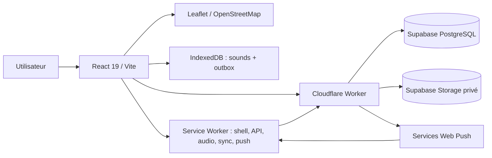
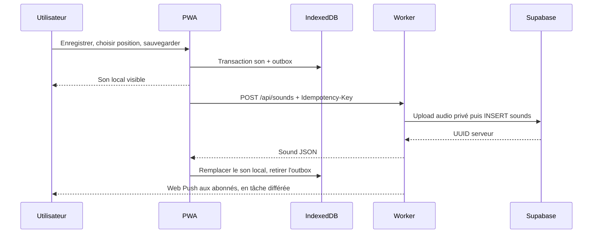

# Architecture actuelle de la PWA

## Vue générale

Le Worker sert aussi les fichiers statiques construits dans `dist/` via la liaison `ASSETS`. Le proxy Vite redirige `/api` et `/uploads` vers `localhost:8798`. Le backend Express `server/index.js` sur `3001` sert aux essais historiques V1 ; il possède des routes et règles différentes et ne doit pas définir le contrat de la future app.

## Où se trouve chaque responsabilité

| Couche | Fichiers | Rôle |
| --- | --- | --- |
| Entrée et navigation | `src/main.jsx`, `src/App.jsx` | Assemble carte, liste, enregistreur et bannières ; gère `?action=record` et `?sound=<id>` |
| Carte et liste | `src/components/SoundMap.jsx`, `SoundPanel.jsx`, `LocationPicker.jsx` | Marqueurs par catégorie, filtres, sélection, lecture audio et choix manuel d'un lieu |
| Capture | `src/components/RecordModal.jsx`, `src/utils/recorder.js`, `position.js` | Permissions après action utilisateur, MediaRecorder, validation de position et préécoute |
| Données locales | `src/hooks/useSounds.js`, `src/utils/db.js` | Lecture locale d'abord ; stockage des sons, blobs et demandes d'envoi dans IndexedDB |
| Envoi | `src/utils/sync.js` | Multipart HTTP, clé d'idempotence stable, reprise de l'outbox |
| PWA | `public/sw.js`, `src/utils/sw-register.js`, `build/` | Cache, Background Sync, mise à jour contrôlée et réception Web Push |
| Abonnement push | `src/components/PushButton.jsx`, `src/utils/push.js` | Abonnement volontaire, jeton local de gestion, désabonnement |
| API et persistance distante | `worker/index.js`, `worker/push.js`, `supabase/*.sql` | Validation, Supabase, service audio privé et notifications |
| Déploiement | `wrangler.jsonc`, `vite.config.js`, `public/_headers` | Worker, assets statiques, proxy local, en-têtes |

`src/utils/notifications.js` contient des helpers de notification locale, mais le parcours V2 utilisé par l'interface passe par `PushButton` et Web Push. Ne pas confondre ces helpers avec une fonction produit active.

## Modèle de données

La table `public.sounds` est définie dans `supabase/setup.sql` : `id` UUID, `client_id` unique, `title`, `description`, `latitude`, `longitude`, `category`, `audio_path` unique, `created_at`. Le Worker expose ces champs en camelCase et construit `audioUrl` sous `/uploads/<audio_path>`. Il ajoute `version: 1` et `synced: true` dans les réponses ; **la V2 n'implémente pas une édition avec version côté serveur**. Les catégories sont `mer`, `nature`, `village`, `animal`, `musique`, `marche`, `autre`.

Le bucket Supabase `sounds` est privé, limité à 10 Mio par fichier et aux types audio autorisés. La table `push_subscriptions_v2`, créée dans `supabase/v2.sql`, garde endpoint, clés de chiffrement et empreinte du jeton de gestion. Elle est limitée à 20 abonnements par sa fonction d'inscription. Les deux tables ont RLS et sont manipulées par le Worker avec une clé serveur ; le client ne les interroge pas directement.

Dans IndexedDB (`corsica-soundscape`, version 1), le store `sounds` est indexé par identifiant et le store `outbox` a une clé numérique auto-incrémentée. Un son en attente porte un identifiant `local-<UUID>`, un `clientId`, un `audioBlob` et `synced: false`. Une transaction enregistre ensemble le son et son entrée d'outbox. Après réponse du Worker, la même logique remplace l'identifiant local par l'UUID serveur et retire l'entrée d'outbox, en gardant le blob local.

## Parcours de lecture

1. `useSounds` lit IndexedDB et affiche immédiatement les sons présents.
2. Si le navigateur est en ligne, `GET /api/sounds` actualise la base locale. La réponse réseau porte `X-Soundscape-Source: network` ; une réponse de secours du service worker porte `cache`.
3. Lors d'une vraie réponse réseau, les sons synchronisés absents du serveur sont retirés de la base locale ; les sons en attente restent. Les audios correspondants sont retirés du cache quand possible.
4. La carte affiche les marqueurs ; le panneau filtre les catégories et lit en priorité un blob local, sinon `/uploads/...`. Les fichiers audio lus sont mis en cache par le service worker.

## Parcours de création et synchronisation

Le micro est demandé uniquement au démarrage de la capture. Le GPS est demandé au clic ; le lieu peut aussi être choisi sur une carte ou saisi par coordonnées. La capture est refusée si elle dépasse 10 Mio ou si aucun audio exploitable n'a été produit. Le formulaire doit avoir titre, audio et position valide. Une fois la transaction locale réussie, le formulaire peut se fermer même si le serveur est inaccessible.

L'envoi est relancé à l'ouverture, au retour du réseau, au retour du focus, toutes les 30 secondes si l'outbox n'est pas vide, ou via Background Sync quand disponible. `src/utils/sync.js` utilise Web Locks si possible pour éviter les envois concurrents. L'idempotence repose sur `clientId` transmis dans `Idempotency-Key` et sur `sounds.client_id` unique. Un nouvel INSERT HTTP 201 déclenche l'envoi push ; une répétition idempotente retourne HTTP 200 et n'en renvoie pas.

## Hors connexion et mise à jour

Le build précache le shell et les bundles. Le service worker sert le HTML de la même version que ses bundles, utilise le réseau puis le cache pour l'API, et garde les audios déjà consultés dans `soundscape-data-v1`, avec prise en charge des requêtes `Range`. La configuration push contourne ce cache. Les tuiles OpenStreetMap ne sont pas téléchargées en masse : la carte de fond peut manquer hors ligne, même si les marqueurs et les coordonnées locales restent utilisables. Les enregistrements en attente sont dans IndexedDB, pas uniquement dans le cache HTTP.

Une nouvelle version du service worker attend le clic de l'utilisateur sur la bannière de mise à jour (`SKIP_WAITING`). Le service worker est désactivé en mode Vite `dev`. Le clic sur une notification ouvre `/?sound=<id>` ou envoie `OPEN_SOUND` à une fenêtre déjà ouverte ; la lecture audio exige ensuite une action de l'utilisateur.

## Limites et points d'attention

- Le client V2 n'a ni compte utilisateur, ni édition/suppression publique des sons, ni synchronisation des modifications concurrentes. Le `PUT`/`If-Match` du serveur Express ne fait pas partie de l'API de production.
- `GET /api/sounds` retourne toute la liste, avec pagination Supabase interne par lots de 1000 ; aucun filtre, curseur ou pagination client n'est exposé.
- Le service de push limite l'inscription et l'envoi aux 20 abonnements prévus par cette démo. C'est un plafond produit à revoir avant montée en charge.
- La disponibilité hors ligne de l'audio dépend des blobs locaux et des audios déjà consultés ; tout le catalogue n'est pas préchargé.
- Le Worker accepte les créations publiques sans authentification. Avant une diffusion plus large, prévoir une stratégie explicite contre le spam et l'abus, et une politique de modération.
