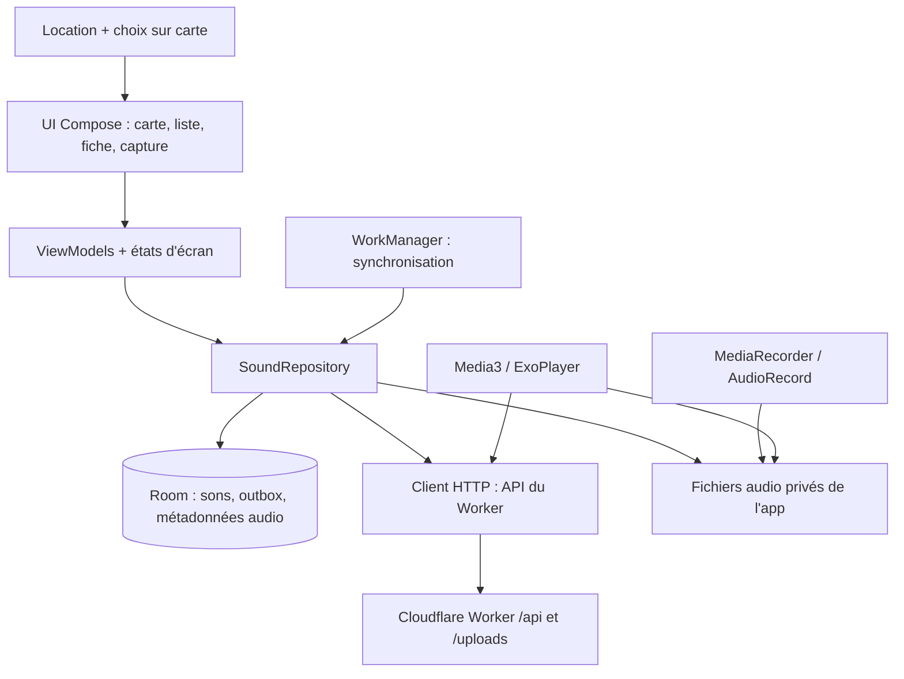

# Migration vers une application Android native en Kotlin

## Objectif et frontières

Créer une nouvelle interface Android native, tout en réutilisant le Worker Cloudflare et les données Supabase. Le dépôt ne contient pas encore de projet Android : les éléments ci-dessous sont **une architecture cible**, pas des fonctions déjà livrées. Ne jamais placer `SUPABASE_SECRET_KEY` ni la clé privée VAPID dans l'application. Conserver la PWA en fonctionnement pendant la migration.

## Architecture cible

Découpage conseillé : `app` (navigation et injection des dépendances), `feature:map`, `feature:sounds`, `feature:record`, `core:model`, `core:network`, `core:database`, `core:media`, `core:sync`. Commencer en un seul module Gradle si le projet est petit ; garder ces frontières par packages et extraire des modules seulement quand elles deviennent utiles. Utiliser des ViewModels avec `StateFlow` et des modèles distincts pour DTO réseau, entités Room et état UI.

| PWA actuelle | Équivalent Android proposé | Détail à préserver |
| --- | --- | --- |
| `SoundMap`, Leaflet | Carte Android (choisir un fournisseur et vérifier ses conditions d'utilisation) | Centre Corse, marqueurs par catégorie, sélection et déplacement vers un son |
| `SoundPanel` | Liste/fiche Compose + lecteur Media3 | Filtres, état d'attente, préécoute locale et lecture distante |
| `RecordModal`, MediaRecorder web | Écran Compose + API de capture audio Android | Permission micro au geste utilisateur, arrêt/libération, préécoute, limite 10 Mio |
| Géolocalisation web et `LocationPicker` | API de localisation Android + choix manuel | Permission au geste utilisateur ; saisie des coordonnées disponible si GPS refusé |
| IndexedDB `sounds`/`outbox` | Room + fichiers audio dans stockage privé | Enregistrer métadonnées et tâche d'envoi dans **une transaction** ; fichier audio durable avant la transaction |
| Service Worker + Background Sync | WorkManager avec contrainte réseau | Reprise après fermeture, redémarrage et reconnexion ; backoff pour erreurs temporaires |
| Cache API audio | Cache Media3 ou fichiers gérés par le dépôt | Ne promettre hors ligne que les audios réellement conservés |
| Web Push | Nouvelle intégration FCM native **et extension backend** | Le contrat Web Push actuel ne reçoit pas de token FCM |
| Bouton d'installation PWA | Distribution APK/AAB | Disparaît de l'interface native |

## Modèle local et synchronisation

Proposer `SoundEntity(serverId?, localId, clientId, title, description, latitude, longitude, category, createdAt, audioPath, syncState)` et `OutboxEntity(localId, clientId, attempts, lastError, createdAt)`. La capture est conservée dans un fichier privé de l'app ; Room stocke son chemin, pas un gros blob. `clientId` est généré une seule fois et reste stable sur tous les essais. Prévoir des états `PENDING`, `UPLOADING`, `SYNCED`, `ACTION_REQUIRED` ; une fermeture pendant `UPLOADING` doit remettre la tâche en attente au redémarrage.

Algorithme conseillé : écrire le fichier audio, valider métadonnées et MIME, insérer son + outbox en transaction Room, rendre le son visible, planifier un travail unique de synchronisation. Le worker Android lit l'outbox dans l'ordre, construit le multipart, envoie `Idempotency-Key`, puis met à jour le son et supprime la tâche dans une transaction. Une réponse `201` ou `200` termine l'envoi. Un timeout, `502`, `503` ou une perte de réseau garde la tâche et applique un délai de reprise. Un `400`, `413` ou `415` passe en `ACTION_REQUIRED` et affiche une correction possible. Attention : le Worker ne garantit pas une pagination de la liste et la réponse réseau peut être volumineuse.

Au lancement, observer Room pour afficher immédiatement les données locales. Ensuite, charger `GET /api/sounds` et fusionner les résultats en préservant les sons en attente et leurs fichiers. Supprimer les sons distants absents seulement après une vraie réponse `200` du réseau, comme le fait la PWA avec `X-Soundscape-Source: network`. Une erreur réseau ne doit jamais effacer le cache. Pour les sons distants, télécharger l'audio à la demande et conserver les fichiers uniquement selon un budget de cache défini.

## Permissions, média et sécurité

- Micro : demander `RECORD_AUDIO` seulement quand l'utilisateur démarre la capture ; libérer l'enregistreur quand il arrête ou quitte l'écran. Choisir un encodeur disponible dont le MIME final est accepté par le Worker, par exemple AAC dans MP4/M4A si l'appareil le prend en charge. Tester le fichier produit, sa taille et son MIME avant mise en file.
- Position : demander la localisation quand l'utilisateur choisit « Ma position ». Garder le choix manuel et la saisie de latitude/longitude, qui couvrent le refus de permission et l'absence de GPS. La PWA valide les bornes géographiques globales, pas une frontière géographique de la Corse.
- Lecture : utiliser une source fichier privé si disponible, sinon l'URL HTTPS `/uploads/...`. Gérer `Range`, interruptions audio et erreurs hors ligne. Le téléchargement préalable de tout le catalogue n'est pas prévu.
- Réseau : utiliser HTTPS en production, un délai explicite et une gestion séparée des erreurs permanentes et temporaires. Ne pas embarquer de secret serveur. Tester la taille du multipart avant envoi.
- Notifications : demander la permission Android seulement quand l'utilisateur active la fonction. Définir d'abord l'extension FCM du Worker et le cycle de vie du token. Éviter d'envoyer à la fois une notification Web Push et une notification FCM au même utilisateur sans règle de déduplication.

## Plan de réalisation

1. **Contrat et socle** : figer des exemples JSON réels et des cas d'erreur avec les tests du Worker ; créer l'application Kotlin/Compose, client HTTP et modèles DTO.
2. **Lecture** : Room, synchronisation descendante, liste, carte, filtres et lecteur audio. Vérifier les mêmes sons que la PWA, y compris après un redémarrage hors ligne.
3. **Création** : capture, préécoute, titre/catégorie, GPS et choix manuel ; enregistrer localement avant tout appel HTTP.
4. **Envoi durable** : outbox Room, WorkManager, clé d'idempotence, reprise sur timeout et rapprochement de l'UUID serveur. Tester une coupure après upload puis une répétition `200`.
5. **Notifications** : ajouter côté Worker un contrat FCM natif et son stockage ; implémenter le consentement et la réception Android. Cette étape dépend d'une décision de backend.
6. **Validation finale** : tests sur appareil réel pour permissions, formats audio, faible réseau, mode avion, redémarrage, taille limite et liens ouvrant le bon son ; vérifier que la PWA continue de fonctionner.

## Critères de parité minimale

Un utilisateur peut voir la carte et la liste hors ligne après une première ouverture en ligne, écouter les fichiers déjà conservés, enregistrer un son sans réseau, choisir une position même sans GPS, retrouver l'enregistrement après redémarrage, l'envoyer une seule fois malgré des retries, puis voir l'identifiant serveur et écouter le son depuis un autre appareil. Les notifications natives sont un chantier séparé tant que l'API FCM n'existe pas.
